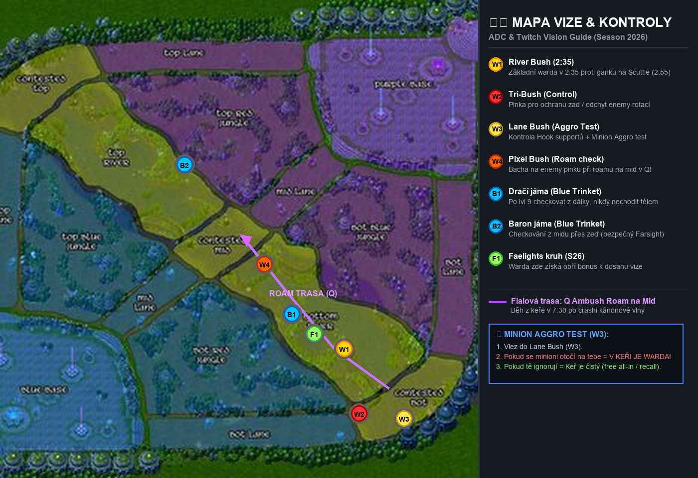

# ⏱️ MASTER ROAM, RECALL & TIMING MANUAL: ADC & Twitch Blueprint

> **Hráč:** In the Dark#CHALL / Orbwalk#ONN  
> **Účel:** Přesné časové osy, pravidla pro recall, roamovací okna a časovače cílů na mapě.  
> **Základní pravidlo:** *Každý krok na mapě musí mít důvod. Náhodný pohyb = ztráta LP.*

---

## 🕒 1. Časová osa zápasu (Co přesně dělat v každé minutě)

Tento rozvrh ti přesně řekne, na co máš v danou minutu myslet:

```
[00:00 – 00:30] ──► Příprava na linku / Invade defense / Bush control (spawn minionů z báze v 0:30!)
[00:55]         ──► 🌲 Jungle camps spawn (buff spawnuje v 0:55)
[01:00 – 02:15] ──► Level 2 race (1. vlna se potká kolem 1:00, Lvl 2 naskočí po 1. vlně + 3 melee)
[02:40 – 03:00] ──► 🚨 POZOR: Jungle gank okno & Scuttle Crab spawn v řece (2:55!)
[03:20 – 04:10] ──► 1. CHEATER RECALL OKNO (Crash 3. vlny s kanónem)
[05:00]         ──► 🐉 Dragon spawn (první drak)
[05:30 – 06:15] ──► Level 6 power spike (odemčení R – all-in / kill hrozba)
[07:00 – 08:30] ──► 🪟 PRVNÍ ROAM OKNO NA MID (Fake Recall / Cannon crash)
[09:00 – 14:00] ──► Tlak na věž, permanentní pláty (S16), druhý drak setup
[14:00+]        ──► 🔄 MID SWAP: Odchod z botu na midlane, sběr vln a objektivů
[20:00]         ──► 👾 Baron Nashor spawn (držet se v bezpečí, 45s setup)
```

---

## 🔄 2. Zákony správného RECALLU (Kdy smíš zmáčknout „B“)

Největší důvod, proč hráči v Platině ztrácejí 2 levely a 40 CS, je **špatný recall**.

### 🟢 Tři legální důvody pro Recall:
1. **Cannon Wave Crash (Zlatý standard):**
   * Narveš vlnu s kanónem pod nepřátelskou věž. Kanón věž zabíjí 8 ran.
   * Než enemy vyčistí kanóna, dáš 8s recall, nakoupíš a doběhneš zpět, aniž bys ztratil jediného melee miniona.
2. **Enemy botlane je mrtvá nebo v bázi:**
   * Zabijete je $\to$ **okamžitě shove (vytlačit vlnu pod věž)** $\to$ okamžitý recall.
   * *Chyba:* Zůstat na lince a brát plát s 200 HP, když přichází enemy jungler.
3. **Máš v kapse přesný item spike:**
   * Máš 1000g (Serrated Dirk komponenty) nebo 1100g (Berserker's Greaves).

### 🔴 Tři zakázané situace pro Recall:
* ❌ Vlna je uprostřed linky a ty máš plné HP (daruješ nepříteli freeze).
* ❌ Vlna se sune k tvé věži (ztratíš celou vlnu + pláty).
* ❌ Drak spawnuje za 25 sekund a ty dáváš recall (tvůj tým bojuje 4v5).

---

## 🪟 3. Jak si vytvořit ROAMINGOVÉ OKNO (Krok za krokem)

Roam se nedělá náhodně. Roam je **matematická příprava**:

```
[KROK 1: Příprava vlny (6:30 – 7:00)] 
└── Pomalý push (Slow push) – nech své miniony nakupit.

[KROK 2: Tvrdý push (7:00 – 7:30)] 
└── Přijde kánonová vlna. Wčko + spamy auto-attacků + E. Vlna naráží do věže!

[KROK 3: Fake Recall (7:30 – 7:45)] 
└── Vlez do keře na botu. Enemy botlane si myslí, že dáváš B.
└── Zmáčkni Q (Ambush) a vyběhni řekou směrem na MID!

[KROK 4: Exekuce na Midu (7:45 – 8:00)] 
└── Vylez z Q za zády enemy midlanera. W pod nohy ➔ Ghost ➔ kill.
└── Akce trvá MAX 10 sekund!

[KROK 5: Návrat na Bot (8:00 – 8:20)] 
└── Neber midové miniony! Běž zpět na bot, kde na tebe čeká odražená vlna.
```

---

## ⏰ 4. Časovače na mapě (Objective Timers Checklist – Season 2026)

Jako ADC musíš mít v hlavě tyto přesné časy:

| Objektiv / Událost | První spawn | Respawn čas | Kdy začít přípravu (Recall / Ward) |
| :--- | :---: | :---: | :--- |
| 👶 **Spawn Minionů z báze** | **00:30** | každých 30s | Být v pozici v keři / na lince v 0:45. |
| 🌲 **Jungle kempy (Red/Blue)** | **00:55** | 2:15 min | Hlídej start enemy junglera (leash bot vs. leash top). |
| 🦀 **Scuttle Crab v řece** | **02:55** | 2:30 min | 🚨 River warda v čase **2:35 – 2:45** (hlídá gank!). |
| 🐉 **Drak (Dragon)** | **05:00** | 5:00 min | **V čase 4:15 (45s před spawnem):** Recall, nákup, příchod k řece. |
| 👾 **Baron Nashor** | **20:00** | 6:00 min | **V čase 19:15:** Crash mid vlny, wardy kolem Barona. |
| 🛡️ **Permanentní pláty (S16)** | **Celou hru** | Nepadají | Tlak na věž platí i po 14. minutě. |

---

## 🚨 Rychlý checklist před každým pohybem:

Polož si tuto otázku předtím, než opustíš linku:
1. **Kde je vlna?** *(Pod jejich věží = MŮŽU jít. Uprostřed/u mě = ZÁKAZ!)*
2. **Stihnu to za 30 sekund?** *(Pokud akce trvá déle než 30s, ztrácím vlnu).*
3. **Mám vizi v řece?** *(Pokud nevím, kde je enemy jungler, jdu přes svou jungle, ne přes řeku).*

---

## 🗺️ 5. Mapa vize: Kde přesně kontrolovat wardy & Roam zóny



### 📍 Legenda k mapě a jak jednotlivá místa kontrolovat:

| Kód | Název místa | Kdy a jak kontrolovat | Proč je to kritické |
| :---: | :--- | :--- | :--- |
| **W1** | 🟡 **River Bush** | **Položit v čase 2:35 – 2:45.** | Chytá enemy junglera těsně před Scuttle Crabem v řece (2:55) nebo gankem na bot. |
| **W2** | 🔴 **Tri-Bush** | **Control Ward (Pinka).** | Klíčové místo pro ochranu zad (Blue side) nebo agresivní odchyt enemy rotací (Red side). |
| **W3** | 🟡 **Lane Bush** | **Minion Aggro Test.** | Zde se schovávají Hook supporti (Nautilus, Blitz, Pyke). **Pokud se minioni otočí za tebou do keře = JE TAM WARDA!** |
| **W4** | 🟠 **Pixel Bush** | **Pozor při Roamu v Q!** | Malý keřík u midu. Žlutá warda tě nevidí, ale pokud tam enemy mid/jg položil **červenou Control Wardu**, odhalí tvůj stealth! |
| **B1** | 🔵 **Dračí jáma** | **Blue Trinket (po lvl 9).** | Nikdy nechoď checkovat draka tělem (facecheck). Hoď modrý trinket ze vzdálenosti celé obrazovky. |
| **B2** | 🔵 **Baron jáma** | **Blue Trinket (po lvl 9).** | Bezpečné odhalení Barona zpoza stěny na midlane. |
| **F1** | 🟢 **Faelights (S26)** | **Kruh hub v řece.** | Warda položená do tohoto kruhu získá v sezóně 2026 obří bonus k dosahu vize! |
| 🟣 | **Fialová trasa** | **Q Ambush Roam na Mid.** | Trasa pro gank v 7:30 po crashi kánonové vlny. Běh podél dračí jámy přímo za záda enemy midlanera. |

---

### 🕵️ Jak bezpečně zjistit, jestli v keři čeká nepřítel (Twitch Spells):
1. **W (Venom Cask) Check:** Hoď Wčko naslepo do keře. Pokud tam někdo sedí, **uslyšíš zvuk zasažení a vteřinu na to naskočí 1 stack jedu**.
2. **Q (Ambush) Warning Eye:** Přibliž se ke keři v Q stealthu. Pokud je v keři šampion nebo Control warda, nad hlavou ti blikne **žluté/červené varovné oko** $\to$ okamžitě ustup!
